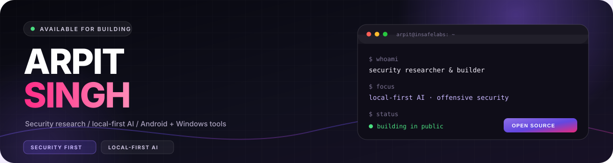

<div align="center">



<p>
  <a href="https://insafelabs.in"></a>
  <a href="https://github.com/arpitsingh404"></a>
  <a href="mailto:arpitsingh404@proton.me"></a>
</p>

<p>
  
  
  
</p>

</div>

---

## About me

I build tools that do real work: **local-first AI operators, security platforms, Android apps and Windows automation**.

- Currently building **InSafeLabs**, **Student Vault** and local-first AI agents.
- Interested in offensive security, agentic AI, encrypted local storage and desktop automation.
- I care about tools that work offline, keep data on the device and explain what they are doing.
- Everything security-related here is for **authorized testing only**.

```text
$ whoami
Arpit Singh — security researcher & builder

$ focus
local-first AI  ·  application security  ·  Android + Windows

$ principle
Keep the data local. Make the behavior visible. Test before shipping.
```

## Currently building

| Project | What it is |
| --- | --- |
| [**Student Vault**](https://github.com/arpitsingh404/student-vault) | Encrypted, local-first Android vault for documents, reminders and job applications. AES-256-GCM, PIN recovery, encrypted `.svault` files and an on-device assistant. |
| [**InSafeLabs v2**](https://github.com/arpitsingh404/insafelabs-v2) | Local-first offensive security platform: FastAPI + React, 131 tools, native vulnerability suite, playbooks, VAPT/WAPT workflows and an AI agent. |
| [**AEGIS**](https://github.com/arpitsingh404/aegis) | Local AI coding agent for Windows: multi-model routing, skills, plan mode, hooks and a terminal UI. |
| [**Wingman**](https://github.com/arpitsingh404/wingman) | Local-first personal AI operator with real tools: web, files, Python, shell, SSH, Gmail, document RAG and autonomous runs. |

## Featured projects

<table>
<tr>
<td width="50%" valign="top">

### Student Vault
Encrypted Android app for student documents, reminders and job applications. No account, no cloud database; local encrypted storage and portable vault files.

`Android` `JavaScript` `AES-256-GCM` `IndexedDB`

[Repository](https://github.com/arpitsingh404/student-vault) · [Release](https://github.com/arpitsingh404/student-vault/releases) · [](https://github.com/arpitsingh404/student-vault/releases)

</td>
<td width="50%" valign="top">

### InSafeLabs
Local-first security platform for authorized assessments. FastAPI + React, native vulnerability suite, playbooks, AI agent and reporting workflows.

`Python` `FastAPI` `React` `Security`

[Repository](https://github.com/arpitsingh404/insafelabs-v2)

</td>
</tr>
<tr>
<td width="50%" valign="top">

### AEGIS
Local AI coding agent for Windows. Multi-model routing, skills, plan mode, hooks and a focused terminal interface.

`JavaScript` `AI agents` `Windows`

[Repository](https://github.com/arpitsingh404/aegis)

</td>
<td width="50%" valign="top">

### Zumi
A tiny Windows desktop buddy that actually operates the PC: hands-free voice, 38 actions, screen-reading verification and local memory.

`Python` `Windows` `Voice` `Automation`

[Repository](https://github.com/arpitsingh404/zumi-desktop-buddy-ai)

</td>
</tr>
<tr>
<td width="50%" valign="top">

### Wingman
Local-first personal AI operator with real tools, document RAG, autonomous multi-agent runs and a Telegram bot.

`Python` `Local AI` `RAG` `Telegram`

[Repository](https://github.com/arpitsingh404/wingman)

</td>
<td width="50%" valign="top">

### DeskClock
Seven live WPF widgets for Windows 11: clock, system, battery, weather, network, map and PC health. Real data, no admin rights.

`PowerShell` `WPF` `Windows 11`

[Repository](https://github.com/arpitsingh404/deskclock)

</td>
</tr>
</table>

**Also open source:** [proxyvpn](https://github.com/arpitsingh404/proxyvpn) — Chrome MV3 proxy-profile switcher (HTTP/HTTPS/SOCKS4/5, auth, bypass lists) · [ai-coding-agent](https://github.com/arpitsingh404/ai-coding-agent) — multi-file agentic coding assistant for VS Code

## Tech stack

<p>
  
  
  
  
  
  
</p>
<p>
  
  
  
  
  
  
</p>

## GitHub at a glance

<p align="center">
  <a href="https://github.com/arpitsingh404"></a>
  <a href="https://github.com/arpitsingh404?tab=repositories"></a>
  <a href="https://github.com/arpitsingh404?tab=overview"></a>
</p>

<p align="center">
  <a href="https://github.com/arpitsingh404"></a>
</p>

<p align="center">
  <picture>
    <source media="(prefers-color-scheme: dark)" srcset="https://raw.githubusercontent.com/arpitsingh404/arpitsingh404/output/github-contribution-grid-snake-dark.svg" />
    
  </picture>
</p>

## Let's connect

- Website: [insafelabs.in](https://insafelabs.in)
- GitHub: [@arpitsingh404](https://github.com/arpitsingh404)
- Email: [arpitsingh404@proton.me](mailto:arpitsingh404@proton.me)

I am open to collaborations on **local-first AI, Android apps, security tooling and Windows automation**.

---

<p align="center">
  <i>Keep the data local. Make the behavior visible. Test before shipping.</i><br/>
  <sub>Authorized testing only. Never test systems you do not own or have permission to assess.</sub>
</p>

